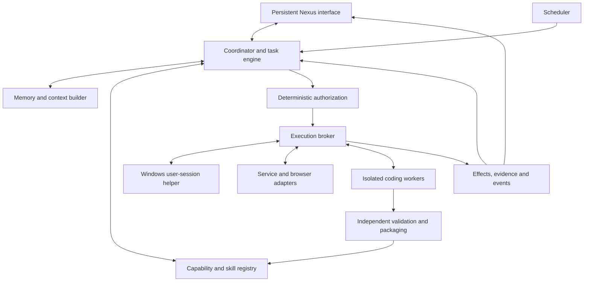
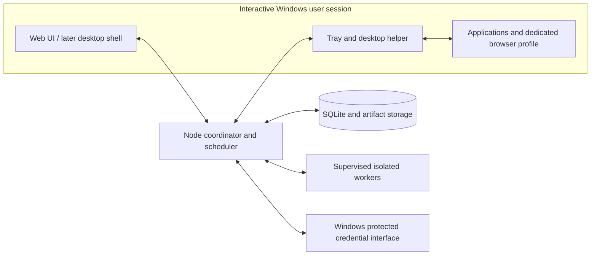
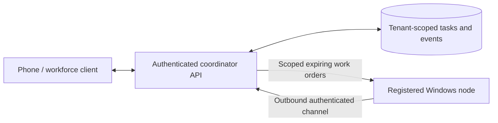

# Nexus personal assistant: reconciled architecture and build plan

## Owner video and Galaxy reference — November 25, 2026

The governing interpretation of the supplied second-brain video excerpt and four screenshots is [Applied video and screenshot contract](../nexus-second-brain-reference.md), with [timestamped source evidence](../references/second-brain-video-owner-excerpt.md). The complete YouTube transcript was not retrieved: the current workspace network policy blocks YouTube. Do not represent the owner-supplied excerpt as a verified full transcript.

Build toward model-independent, provenance-bearing shared memory and the luminous purple/indigo, white/lilac-core, cyan-arm spiral shown in the pictures. Preserve the owner's later explicit choices: no visible file-connection lines, contextual names, freely rotatable views and fullscreen with state preservation. The Obsidian graph image describes relationships, not the default Galaxy appearance.

Current slices already deliver portable snapshots, the opt-in completed-task journal, local work-context retrieval, original-file controls, separate browse-only storage navigation and the original-style spiral. They do not yet deliver universal agent memory, continuous conflict-aware note synchronization, global-memory metrics or exact reference-image lighting. The linked contract defines the next visual, memory-service, note-lifecycle and search/scale stages with acceptance evidence. Existing permission boundaries and enabled journal authorization remain in force.


Original reconciliation: November 11, 2026. Memory Galaxy requirements consolidated November 23, 2026. This is an architecture/build plan, not a claim that all proposed capability is delivered. The owner reuploaded the 50-section architecture specification and requested reconciliation before further implementation. Nexus replaces JARVIS throughout. Sample scenarios are not live work orders and are not included as operational tasks here.

## Product and established decisions

Nexus is one personal assistant that owns goals across conversations, business screens and model changes. It interprets requests, retrieves relevant memory, plans, delegates, checks effects and follows through. Tools and reusable skills expand its capabilities; the interface is not a ceiling of predefined workflows.

The normal experience is a persistent conversation with visible listening, speaking and task status. Business workspaces provide focused views of the same underlying work. Internal adapters, hashes and debugging belong in expandable technical views rather than the first screen.

| Requirement | Classification | Proposed treatment |
| --- | --- | --- |
| Nexus identity; Windows first | Established | Preserve existing repository and Windows launcher |
| Voice available across management screens | Established | Root-mounted conversation controller; native tray/helper later |
| Dark background, cyan accents, clearer navigation | Established | Navy surfaces, high-contrast text, restrained cyan status/action accents |
| Persistent memory, rules and tasks | Established | Application-owned transactional records, independent of model provider |
| Memory Galaxy / file stars across bases | Established owner requirement | Preserve the original animated spiral; no file-connecting lines; focus/zoom neighborhoods, then explicitly open files; extend to host drives/folders/files |
| Broad files, browser, applications and terminal capability | Established target | Incremental execution broker and Windows helper; current read-only search remains useful |
| Use Codex and Claude as workers | Established target | Separate adapters with bounded work orders and supported authentication |
| Gemini free now, paid later | Established | Retain separate public-only Gemini; no private-context fallback |
| Daily brief | Established | Cape Coral timezone America/New_York, weekdays 05:00; protect 08:00–11:00; Monday week view |
| Cross-platform customer/workforce apps and subscriptions | Established target | Separate named identities and company isolation before external users |
| Booking, monitoring and archive examples | Illustrative only | No real bookings, applications or sample data created |
| Continuous operation while PC is off | Later deployment choice | Requires another available execution/delivery node |

## Current baseline and gaps

Repository features and the owner's laptop observations are different evidence. These observations are reported by the owner; this design review did not independently inspect their accounts or laptop.

| Area | Existing evidence | Remaining work |
| --- | --- | --- |
| Conversation | Local Ollama answers and local voice reported working | Persistent cross-screen assistant, interruption polish, clearer status |
| Knowledge | Selected laptop folder, Obsidian notes and Google snapshots searched; explicit note links implemented | Broader coverage, OCR, evidence-based semantic links, fine-grained sharing |
| Files | Selected-index file stars/original-byte reads and selected-folder metadata navigation fixture-tested | Drive/special-folder discovery and grants, unindexed/image viewing, folder stars, other-host/native storage |
| Google | Two calendar accounts and six selected Drive documents reported readable | Gmail, writes, delivery, additional workflow-specific connectors |
| Gemini | Public-only generation reported successful | Paid/private mode requires a separate reviewed change |
| Foundation | SQLite tasks/owner memory, local work context and planning implemented; optional work journal fixture-tested and locally enabled by owner | General execution contracts, broader effect reconciliation, verified observations and memory synchronization |
| Coding | Codex candidate generation, checks and isolated USD utility verified in walkthrough | General skill contracts, additional verification profiles, Claude adapter, release supervisor |
| Co-hosting | Internal lead/estimate/job rehearsal implemented | Named customer/workforce accounts, actual photos, invoices and provider reconciliation |
| Automation | Fixed service maintenance and morning scheduling implemented | General Windows actions, browser control, monitors and tested recovery |

## Logical architecture and responsibility



The model proposes interpretation, plans and candidate lessons. Software validates schemas, permissions, revisions, schedules, leases, budgets and transitions. An adapter reports observations; the verifier checks task acceptance criteria. A model declaring success cannot complete a consequential task by itself.

| Component | Input/output | Authoritative state | Dependency/failure behavior |
| --- | --- | --- | --- |
| UI | Commands, corrections, events and artifacts | Draft text and presentation preferences only | Reconnect from event cursor; do not resend unknown actions |
| Coordinator | Task revisions → work orders and progress | Tasks, plans, checkpoints | Recover durable state after restart |
| Context builder | Task scope → relevant sourced context | No separate competing memory | Mandatory rules cannot be removed by relevance ranking |
| Policy | Typed action + grants → decision and reason | Versioned rules/grants | Missing rules store blocks affected actions |
| Broker | Approved invocation → execution receipt | Invocations, resource leases | Recheck revision and expiry immediately before dispatch |
| Helper/adapters | Typed operations → observations | Account/session references and operation cursors | Return authentication/device/uncertain-effect states |
| Registry | Capability query → compatible versions | Descriptors, skill versions, health | Exclude disabled/incompatible versions |
| Workshop | Bounded work order → candidate artifacts | Candidate and validation evidence | Never edit the active runtime in place |
| Scheduler | Durable schedule → task occurrence | Timezone, recurrence, cursor, receipt | Deduplicate runs and apply explicit missed-run policy |
| Verifier | Acceptance criteria + observations → outcome | Evidence references and verdict | Surface partial or unknown effects |

## Windows deployment and later devices



Start with the existing Node/Next application, Python speech worker and SQLite foundation. Add a narrowly scoped Windows helper only for capabilities that need native APIs. The web UI does not run as administrator. Administrative work uses a separate explicit elevation path; UAC and protected desktops may require owner participation. A Windows service cannot be assumed to control the interactive desktop.

At login, the launcher/supervisor starts configured components and checks readiness. A browser close ends browser microphone capture; already durable server work can continue while its processes remain alive. Lock pauses interactive desktop actions. Sleep pauses local execution; resume reconciles interrupted actions before retrying. Shutdown/sign-out availability depends on process deployment and must be tested. Crashes expire leases and preserve uncertain effects. Updates checkpoint work, back up state and use a separately recoverable supervisor.



Later cloud coordination uses device registration, rotating credentials, revocation, sequence numbers and reconnect cursors. Commands have stable IDs, expiry and deduplication records. An offline node does not receive expired work on reconnect. One configured deployment owns each task's authoritative state; clients cache views. Sensitive policy conflicts require reconciliation rather than silent last-write-wins. A phone app does not automatically gain control over other phone applications.

## Task ownership, workers and state machines

One coordinator owns each task. A worker receives objective, task revision, relevant sources, allowed resources/actions, deadline, budget, output schema and verification requirements. Independent work may run concurrently in isolated workspaces; shared desktop/profile/project resources require leases. Worker output remains evidence to assess, not authoritative completion.

```text
accepted → planned → running → verifying → completed
            ↕          ↕          ↓
       clarification  waiting   partial / failed
                       auth / device / quota / decision
Any nonterminal state → paused / blocked / cancelled
Resume → recheck current revision, authority, external state and resources
```

External effects have a separate lifecycle: prepared → authorized → dispatched → acknowledged → observed → verified. A timeout after dispatch becomes uncertain, then reconciled. Provider idempotency keys are used where supported; otherwise query external state before retrying. Cancellation stops pending work, not history. Completed payments/messages remain reported even if the parent task is cancelled. Compensating actions are separate scoped operations.

Owner corrections increment task revision, invalidate pending conflicting dispatches and notify workers. Leases carry fencing generations where the execution surface can enforce them; software must not claim fencing guarantees for arbitrary unrestricted code. Human mouse/keyboard takeover pauses desktop actions and requires a fresh observation before resumption.

## Memory, rules and context

SQLite is authoritative for profile/preferences, scoped facts, projects, commitments, entities/relationships, corrections, rule revisions and task/event references. Skills live as versioned packages referenced by database records. Credentials live outside general memory. Markdown/Obsidian is source material or an explicit export/import surface, not a second silently competing authority.

Each memory fact records source, stated/observed/inferred status, scope, sensitivity, observed/valid/expiry dates, active/disputed/superseded status and correction links. Inferred facts never silently override explicit owner instructions. A client-only tone preference stays attached to that client.

Context assembly: resolve task/project/entities; load applicable mandatory rules; retrieve current relevant facts and commitments; search sources and skills; check freshness/contradictions; select under a budget; attach source IDs. Begin with text search and relational links. Add embeddings only after measured retrieval gaps justify them; text retrieval must keep working without an embedding provider.

Corrections update authoritative records transactionally, supersede old facts, invalidate summaries/indexes and notify affected active work. Explicit “remember” requests have a direct write path. Candidate lessons from workers require validation. If a memory write fails, preserve the result and report that saving failed.

Deletion removes active payloads and derived indexes/caches, and propagates to synchronized copies. Historical artifacts and backups require their own retention treatment; do not promise instant forensic deletion. Backups need transactional snapshots, restore tests and migration checks. Existing foundation storage is not automatically encrypted by this proposal; disk protection, Windows ACLs and recovery keys need native validation.

Rules distinguish advisory preferences, procedural guidance, hard constraints, standing grants and one-task exceptions. An authorization decision binds task/action parameters, account, resource scope, policy revision and expiry. Recheck changed recipients, prices and destinations. Already authorized necessary steps do not trigger redundant prompts. A connector's installation is not permission for every action it exposes.

Retrieved web pages, documents, emails and generated artifacts cannot rewrite owner policy. Browser speech is not proof of owner identity for consequential actions. Credential operations return narrow handles where possible; raw tokens do not enter prompts or ordinary logs. Unrestricted code running as the same Windows user can bypass application-level checks, so stronger containment requires an actual OS boundary, not a prompt or wrapper.

## Capability registry, execution and connectors

A tool performs an operation; a connector binds a service/account; a model adapter handles inference; a worker performs bounded delegated work; a skill describes a reusable method; a workflow composes steps; a plugin packages capabilities. Every callable descriptor declares version, schemas, prerequisites, account/environment, effects, scopes, cost/rate behavior, cancellation and verification.

Search descriptors by intent, resource, health and permission scope rather than loading the entire catalog into every prompt. Health states include installed, available, needs authentication, degraded, outdated, disabled and unsupported.

Prefer supported APIs/CLI, then structured browser/application automation, then visual interaction when appropriate. A denied API scope cannot be bypassed by browser fallback. Use a dedicated automation profile by default; owner-session integration can follow explicit supported attachment and account checks. Re-observe after navigation or page changes. Verify the service result rather than treating a click as success. MFA/CAPTCHA and expired access may require owner action.

Shell invocations use executable plus argument arrays, bounded output/time, declared working directory, controlled environment and process-tree supervision. File tools enforce target paths, link/junction behavior and operation type. Reads, writes, deletes, sends, purchases and access-control changes are distinct scopes.

Retain Google Calendar and selected Drive/Docs/Sheets reads. Add Gmail/drafts/delivery, Tasks/Contacts and business-specific Google services incrementally with actual scopes. Gemini Public remains isolated from private memory, history, voice and sources. Paid/private Gemini is a new configuration/release decision. Claude, Copilot and DeepAI require supported interfaces and account/terms validation; subscriptions are not assumed to provide API credits or redistribution rights.

## Skills, development and recursive improvement

Skill packages contain a readable procedure, manifest, optional executable assets, tests/fixtures, provenance and changelog. The manifest includes trigger/exclusion conditions, parameters/results, compatibility, dependencies, permissions/effects, execution strategy, acceptance/verification, recovery, resource estimates and evidence.

Lifecycle: draft → under test → validated → active; failures can mark degraded/quarantined; replacements supersede old versions. Tasks pin versions. Disablement stops future invocation without deleting historical evidence.

Learning loop: observe request/failure → classify missing knowledge/tool/access/environment/reliability → search existing solutions → define measurable method → bounded experiment or development work order → independent verification → versioned skill/tool improvement → resume original task → measure later outcomes. Parameter changes alone do not create duplicate skills. Memory updates do not train model weights.

Development stays in isolated workspaces with minimized data. Candidate-supplied tests supplement, not replace, independent checks. Promotion checks contracts, effects, dependencies, regression evidence and permissions. The existing USD utility pipeline is a narrow proof of this pattern, not a general plugin sandbox. Arbitrary Windows tools require their own execution isolation and verification profiles.

Core updates use a supervisor outside the component being replaced, schema compatibility checks, pre-migration backup and tested recovery. UI/configuration/skill/connector/core changes have different release policies. Generated changes cannot silently broaden authority, weaken verification or erase failure history. Bound repair depth, builders, time, tokens and spend; stop cycles with no new evidence while preserving actionable work.

## Interface, voice and visual design

Proposed layout: compact navigation for Today, Work, Memory Galaxy, Knowledge and Connections; a persistent Nexus conversation drawer/dock on management screens; focused workspace content; expandable technical details. Separate Google accounts, Google files, laptop sources, model providers and laptop services rather than one long Connections form. Co-hosting shows clear intake → estimate → job → review stages with next actions.

Use navy backgrounds, visibly distinct panel surfaces, readable neutral text and cyan emphasis. Provide keyboard focus, text labels, adequate contrast and reduced-motion treatment; do not use green or animation alone to convey status. Relationship views must use real source evidence and open the underlying source without granting new access. Memory Galaxy specifically represents relationships through selectable file-star neighborhoods, not drawn connecting lines.

Root-mount one browser conversation controller so tab changes, drawer minimization and client-side management navigation do not destroy its state. Keep microphone off during model thinking and speech playback in the current loop. Show listening/muted/thinking/speaking/resume states and a prominent mute control. Stopping speech, pausing listening and cancelling a task are separate actions. Preserve selected voice and explicit saved auto-resume preference. Initial browser permission/autoplay gestures can still be necessary. Browser capture ends on close/navigation/sleep; native continuous operation/wake word requires separate implementation and testing.

Images, OCR, visual interpretation, generation and editing are separate capabilities. Screen capture is on demand or explicitly scoped to a chosen window. Prefer accessibility trees/structured data when reliable; pixel interaction requires current coordinates, display scaling, monitor identity, freshness checks and post-action verification. Ambiguous recipients, amounts or destructive voice instructions require correction before dispatch.

### Memory Galaxy: current governing interface contract

This section and [the consolidated file-star plan](../nexus-file-galaxy-plan.md) govern Memory Galaxy. Later owner refinements replace earlier visual proposals for flat node maps, connecting stems and immediate preview on first selection. Historical progress entries below are not competing requirements.

- Preserve the original animated spiral galaxy on the main dashboard and reuse that style in shared Memory views. Brighter labelled **file stars** represent actual authorized files. Faint decorative stars do not count as files. Keep globe and galaxy independently expandable/fullscreen, with usable fallback, close/Escape and accessible controls.
- Draw no lines between file stars. First selection focuses and zooms the selected file star to the center without reading its contents. Show nearby real file stars; selecting one explores its neighborhood. Open file or selecting the centered star again opens a large readable viewer. Provide Back, Return to galaxy, search/list access, pause/rotation/zoom and reduced-motion support.
- Neighborhood membership must have source evidence: shared folder, explicit note link, or a separately implemented relationship with provenance. Proximity is a navigation layout, not proof that files contain one another or form an AI-inferred hierarchy. Never invent documents to fill the scene.
- The full target is a visual **Computer → Drive → Folder → File** explorer, including Pictures, Downloads, images and documents across owner-accessible host storage. Browse directory metadata lazily with pagination/clustering and breadcrumbs. A file need not first be indexed to be browseable. Do not replace this target with permanent selected-folder-only coverage.
- Browsing, indexing/search, assistant fact memory, private model context and opening an original file are separate operations. SQLite remains authoritative for assistant facts/rules/tasks. Browsing must not silently index entire drives, copy all files into memory or send contents to a provider. Current selected-index text previews do not establish original PDF/image/native-app viewing.
- Use the same host-backed resource service and responsive UI across laptop, phone, ScreenPad and future operating bases. Preserve host/device identity and availability. Browsing laptop files from a phone differs from enumerating the phone's own storage; native device/storage adapters and permissions require independent implementation. Presentation access alone reveals no private file metadata.
- Carry opaque file/source identity, current version and host through browsing/preview/open, rechecking access and freshness before use. A native path, browser byte response or viewer launch needs its bounded adapter; the visual star itself does not confer those rights.

| Area | Current implemented scope | Remaining required work |
| --- | --- | --- |
| Galaxy appearance and interaction | Original-style spiral, line-free indexed file stars, focus neighborhoods, Back/Return and enlarged text previews; fixture checks passed | Owner acceptance of latest focus behavior; whole-computer resource navigation |
| Source coverage | Selected-folder/Obsidian index, lazy directory browsing, local Windows drive/common-folder discovery and separate browse-only storage grants | Broader native availability checks and multi-host storage adapters |
| File viewing | Hash-bound indexed text, selected-folder PDF/text and PNG/JPEG browser views, supported Office downloads | Broader format/native opening adapters and native device acceptance |
| Device surfaces | Shared desktop/mobile Memory UI, Overview Galaxy and controller ScreenPad; globe expansion | Native acceptance per device, offline/unavailable-host states and each additional base's storage adapter |

Track the Explorer work under milestone 4's file/resource adapters and the responsive visual contract under milestone 1. Do not mark the full file-star requirement complete merely because the initial selected-index galaxy is usable.

## Scheduling, resources and costs

Schedules are deterministic records with timezone, recurrence, target capability, scope, cursor and delivery policy. DST, resume and duplicate-process behavior require tests. Brief opening and voice-start triggers reference the same local-day snapshot to prevent duplicate delivery. Email requires a working authorized delivery adapter and receipt; it is not already enabled by Calendar access.

Alarms, reminders, monitors and scheduled tasks have distinct missed-run policies. A monitor persists a cursor, matching criteria, deduplication, quiet hours and meaningful-change threshold. Monitoring does not authorize applications, messages or purchases. Keep unchanged results quiet. Local powered-off delivery remains unavailable without another node.

Budgets apply per owner/provider/task/worker/development project. Track billed, estimated and unknown usage separately. Deterministic polling does not repeatedly call a model. Do not silently switch to paid fallback. Default to one expensive local inference/build at a time on the owner's 8 GB laptop; validate actual resource pressure before increasing concurrency.

## Contract notation and interfaces

All persisted records have stable IDs, schemaVersion and timestamps. Mutable records add revision; sensitive fields carry scope/retention classification. The following are required proposed fields beyond that common envelope, not existing API promises.

| Record | Required fields and references | Owner/lifecycle |
| --- | --- | --- |
| Task/revision | originalRequest, objective, intent, scope, assumptions, criteria, policyRef, budget, deadline, parentId | Coordinator; revisioned states above |
| Plan step/work order | taskRevision, dependencies, capabilityRefs, resources, allowedEffects, outputSchema, verification, leaseRef | Coordinator; queued/running/result |
| Invocation/result | taskRef, actionId, argumentsRef, accountRef, grantRef, idempotencyKey, status, evidenceRefs, uncertainty | Broker; effect lifecycle |
| Capability | identifier, version, schemas, prerequisites, effects, scopes, health, cancellation, verification | Registry; versioned health |
| Skill/execution | packageHash, permissions, procedureRef, tests, compatibility, pinnedVersion, invocationRefs | Registry; draft through retired |
| Fact/correction | type, contentRef, scope, provenance, trust, sensitivity, validTimes, status, supersedes | Memory; active/superseded/deleted |
| Rule/decision | source, actions/resources, conditions, revision, expiry, precedence, rationale, parameterHash | Policy; active/revoked/expired |
| Schedule/cursor | timezone, recurrence, target, missedRunPolicy, lastOccurrence, sourceCursor, deliveryRef | Scheduler; enabled/paused/cancelled |
| Event/evidence | correlationId, taskRef, actor, kind, metadata, payloadRef, observedAt, retention | Event store; append metadata, removable payload |
| Artifact | contentHash, storageRef, mediaType, generatingTask, sensitivity, provenance | Artifact store; retained/deleted |
| Device/advertisement | publicIdentity, ownerOrTenant, capabilities, sessionState, policyRevision, lastSeen | Registration; enrolled/revoked |
| Lease | resourceRef, taskRef, holder, fencingGeneration, expiry, heartbeat | Broker; held/expired/released |
| Improvement/release | parentTask, hypothesis, candidateHash, evaluations, migration, rollback, approvalRef | Workshop/supervisor; candidate/active/reverted |

UI commands return a durable task ID for long work; reads and local validation can be synchronous. Events stream/replay by cursor and correlation ID. Workers receive revision-bound orders; cancellation and steering are explicit messages. The broker checks policy independently of model text. Registry activation requires verified artifact hashes and declared permissions. Migrations version schemas and preserve recoverable backups; incompatible nodes refuse unsupported commands.

Shared errors: invalid_input, permission_missing, credential_missing, device_unavailable, unsupported_operation, transient_service_error, rate_limit, uncertain_effect, verification_failed. Return retryability, affected step, sanitized diagnostics and next useful action. Never reduce uncertain effects to a success boolean.

## Build sequence and acceptance

| Milestone | User-visible result | Dependency and acceptance evidence |
| --- | --- | --- |
| 1. Reconciled assistant shell | Conversation available across management screens; clearer navigation and dark/cyan hierarchy | Preserve existing APIs; desktop/mobile screenshots, keyboard checks, one voice instance across navigation, mute/auth-loss tests |
| 2. Unified task ownership | Conversation can create/steer durable work with recoverable state | Revisioned contracts, event/artifact history; restart and cancellation tests; novel composed task without fixed menu |
| 3. Memory and policy integration | Relevant corrected preferences/rules survive restart and apply to pending work | Transactional correction, scoped retrieval, policy dispatch recheck and deletion tests |
| 4. Windows execution | Authorized file/process/browser actions with honest availability and takeover | Broker/helper contracts, native Windows test environment, path/account verification and uncertain-effect recovery |
| 5. General development path | Missing capability can be built, independently checked and used to resume parent task | General manifests, isolated workers, appropriate verification profiles, rollback and bounded repair tests |
| 6. Daily reliability | Scheduling, quiet monitoring, delivery receipts and supported native invocation | Missed-run/DST/crash tests, actual authorized delivery acceptance |
| 7. External business apps | Customers/workforce submit scoped evidence and managers review | Named identity, tenant/assignment isolation, private uploads; sandbox financial reconciliation before live payments |
| 8. Commercial/remote operation | Subscription onboarding and later phone/cloud continuity | Provider embedding rights, tenant restore/isolation, device revocation, billing/support and real pilot evidence |

These stages extend the existing foundation; they do not claim that milestone 1 alone completes general capability. No confident delivery date is assigned without native helper, provider and commercial-scope discovery.

## Failure and verification matrix

| Scenario | Expected behavior | Evidence type |
| --- | --- | --- |
| Restart mid-task | Recover checkpoint; reconcile dispatched effects | Deterministic + integration |
| Corrected preference | Invalidate stale context; update relevant workers | Deterministic |
| Mid-task rule change | Reject stale dispatch generation | Deterministic + integration |
| Novel task | Compose tools or preserve parent while resolving gap | Simulated end-to-end |
| Known task | Reuse compatible pinned skill | Deterministic + integration |
| Lucky successful skill run | Keep unvalidated generalization in draft | Holdout evaluation |
| Worker falsely reports success | Acceptance verifier withholds completion | Simulated negative case |
| Resource conflict | Lease/isolation prevents silent overwrite | Concurrency integration |
| Owner takes desktop | Pause, yield and re-observe | Native Windows |
| Wrong account active | Block dispatch until account matches | Adapter integration |
| Locked/offline PC | Queue or show waiting; no fake success | Native Windows |
| Quota exhausted | Bounded wait/authorized fallback | Mocked provider |
| Request times out after send | Reconcile before retry | Simulated uncertain effect |
| Price/terms changed | Re-evaluate grant before commit | Adapter contract |
| Document contains commands | Treat as data; keep owner objective | Adversarial fixture |
| Skill asks broader access | Existing policy denies expansion | Deterministic |
| Dependency installation fails | Preserve parent and diagnostics | Workshop integration |
| Alarm missed in shutdown | Apply configured missed-run policy | Simulated clock + native |
| No monitor change | Update cursor quietly | Deterministic |
| Monitor cancelled | Stop future runs/notifications | Scheduler integration |
| Memory deleted | Remove active/derived content; disclose backup retention | Storage/restore |
| Rules database unavailable | Block affected execution | Fault injection |
| Self-update fails | Supervisor restores tested compatible version | Packaged native recovery |
| Tool tries changing policy | OS boundary prevents unauthorized access where configured | Isolation integration |
| Misheard amount/recipient | Resolve material ambiguity | Voice simulation + native |
| Uncertain image observation | Re-observe or explain uncertainty | Visual fixtures |
| Recursive repair cycles | Stop at configured limits; retain evidence | Deterministic |
| Reconnection repeats command | Reject expired/duplicate occurrence | Protocol integration |
| Planning-only request | Produce artifacts without external effects | End-to-end |
| Model replaced | Preserve tasks/memory/policy/identity | Adapter contract |
| Cross-screen voice navigation | Keep one session; mute stays available | Browser integration |
| External customer accesses owner data | Deny outside company/assignment scope | Commercial isolation tests |

Record concise decision summaries, not hidden reasoning. Observability links task, action, account/resource, version, policy and evidence. Track verified completion, corrections, retries, latency and cost without retaining unnecessary sensitive payloads. Test only changed behavior and relevant regressions; native effects require an authorized real environment.

## Decision log, traceability and verification limits

| Decision | Recommendation and rationale | Alternative/consequence or evidence needed |
| --- | --- | --- |
| Local ownership | Keep current local coordinator and SQLite | Cloud always-online operation adds deployment and privacy obligations |
| Interface | Improve existing Next UI first | Desktop shell/helper later for tray/global invocation; validate packaging/license |
| Languages | TypeScript core, existing Python speech; minimal native helper | Avoid unrelated service/language proliferation |
| Memory | Relational records + text search + readable exports | Embeddings only after retrieval evidence; no mandatory graph database |
| File-star interface | Original-style, line-free Memory Galaxy over authorized resources | A visual explorer does not require a graph database or importing every file into assistant fact memory |
| Model strategy | Replaceable adapters; no silent paid fallback | Verify each account's supported integration and usage reporting |
| Permissions | Typed broker checks and scoped grants | Arbitrary same-user code is not a hard sandbox |
| Browser | Dedicated automation profile | Existing-session attachment needs explicit supported account handling |
| Updates | External supervisor and tested recovery | In-place self-modification cannot guarantee rollback |
| Phone | Shared API/contracts now; client later | Full phone OS automation remains platform-specific |

Memory Galaxy traceability: real file identities and supported resource adapters → line-free focus/neighborhood UI → original-source viewer/open adapters → native drive/device, stale-access, preview, fullscreen and keyboard/touch acceptance.

Major requirement traceability: one identity → coordinator/task IDs → steering/restart tests; persistent memory → fact/correction contracts → restart/correction tests; broad access → broker/helper/invocations → native/account/takeover tests; learning → manifests/workshop/releases → holdout/rollback tests; voice/UI → root controller/events → navigation/mute tests; proactive work → schedules/cursors → DST/missed-run tests; business subscription → tenant/assignment contracts → isolation/sandbox tests.

No current provider documentation was live-verified in this reconciliation. Existing code and prior owner walkthroughs establish the baseline above; they do not establish future entitlement. Before implementing new provider/native adapters, check official Codex authentication/programmatic interfaces, Claude Code/Agent SDK authentication and embedding terms, Microsoft interactive services/UI Automation, Google scope/data handling documentation and each connector's limits. Record URL, date, specific claim and confirmed/inferred/unverified status. Do not assume the uploaded model target label is an available model identifier. Existing architecture links are research starting points, not verified guarantees.

The first implementation boundary is milestone 1: persistent assistant placement, clear navigation, accessible dark/cyan styling and preservation of existing voice/privacy/authentication behavior. It does not add arbitrary terminal execution, Gmail sending, payments, extra providers or native microphone capture. Proposed later decisions are whether always-online availability justifies a cloud coordinator, which bounded action classes may execute under standing grants, and what native helper/desktop packaging to adopt after compatibility validation. Existing free-tier Gemini and no-live-money configuration remain in force while those choices are unresolved.

## Cross-device personal assistant requirement — November 17, 2026

The owner reaffirmed that Nexus must become a general personal assistant used throughout daily life on the laptop, phone and in the vehicle. Voice latency work must preserve this goal rather than narrow Nexus to a business dashboard. Shared server improvements apply to authenticated clients connected to that server; they do not establish remote or always-online availability.

Future acceptance must cover authenticated mobile access away from home, reconnects and offline behavior, microphone/background restrictions on iOS and Android, and hands-free vehicle audio and interruption behavior. Bluetooth audio testing and native CarPlay/Android Auto integration are separate milestones, not existing capabilities. An always-available host or coordinator is needed when the laptop sleeps or is offline. Each new action capability needs its own integration and authorization; “full assistant” is a product direction, not a claim of unrestricted or already implemented access.

The owner further requires a central assistant across any chosen connected device, including televisions and other home devices, added one integration at a time. Maintain a device registry with connection health, supported actions, authorization and revocation. Discover actual device protocols before promising control; distinguish audio/display endpoints from controllable devices. Device control remains future work until each adapter and its real-device acceptance checks pass.

### Android first delivery — November 18, 2026

The owner selected Android. The initial installable web app and `/phone` setup flow reuse the current host and controller pairing; native Android services and car/device adapters remain later milestones. See `docs/nexus-android-app.md` for HTTPS prerequisites, always-on migration acceptance and explicit capability limits.

### Conversation-to-task capture and deferred stereo reference — November 19, 2026

The owner asked to retain stereo information until installation. Confirmed manual/photo evidence and the pending real-device checklist are saved at `docs/devices/haudio-cvd1662.md`. Do not treat direct APK, microphone or Android Auto compatibility as tested.

The next milestone-2 slice connects explicit conversation commands to the existing planning task store. “Create a task to…” records accepted work; “Show my tasks” retrieves the selected workspace's latest records. Execution, queueing and steering still use existing Foundation controls. See `docs/nexus-conversation-tasks.md` for limits, retry behavior and acceptance.


### Milestone 2 conversational steering — November 19, 2026

Added scoped task selection, saved status/output retrieval, revision-aware pause/cancel/objective correction and planning-only resume through the existing Foundation state machine. Ambiguity produces choices rather than a guessed mutation; page-session references do not survive reloads, but stable task IDs/state do. Development worker consent is not granted through resume. See `docs/nexus-conversation-tasks.md` for tested boundaries. General composed-task execution and broader effect recovery remain unfinished portions of the architecture; these controls do not claim milestone 2 as universally complete.

### Planning artifact quality repair — November 19, 2026

Native acceptance exposed that saved/read-back planning text could be factually wrong and token-truncated. Added implemented Nexus context, a distinct bounded planning generation budget and explicit incomplete-draft retention/limited quality checks. Storage integrity is not semantic verification. See `docs/nexus-planning-quality.md`; the original poor artifact remains historical evidence, and live usefulness acceptance is still required.

### Conversational memory integration

Milestone 3 now has a conversational interface to the existing owner memory store: explicit save/list/correct/forget commands with scoped selection, revision checking and local-only handling. Memory/context revisions prevent old conversation history and in-flight answers from reusing superseded context; the existing coordinator invalidates stale active plans. This does not create new action grants or claim every fact/preference is mandatory model context. See `docs/nexus-conversation-memory.md` for the supported boundaries and deletion semantics.

### Initial conversational Windows maintenance slice

The existing locally enabled maintenance adapter is now reachable through whole-request commands “Check laptop services” and “Start missing Nexus services” in Auto/Local mode. It retains controller authorization, Windows-host checks, a fixed script allowlist, shell-free execution, one active maintenance operation and private audit references. Permission is rechecked after audit I/O before child-process dispatch. This is an initial milestone-4 integration slice, not the general execution broker, arbitrary terminal, file mutation or browser helper. Both Copilot products remain separate retained connection targets; see the connections roadmap.

### Conversational selected-folder access

The next milestone-4 slice exposes existing bounded selected-folder status, index refresh and lexical search through Auto/Local conversation. It retains local folder selection, freshness/path checks, exclusions and controller authorization. Literal passages do not invoke models or execution tools. See `docs/nexus-conversation-files.md`. General file writes, process control and browser/helper contracts remain pending rather than being implied by this read-only integration.

### Version-bound indexed-file reading

Conversational selected-folder search now provides direct file-reading controls with bounded parts and source locations. Part continuation is pinned to the selected content hash and revalidates current selected-folder access. Duplicate names require explicit selection; stale versions are rejected. This extends the milestone-4 read-only slice and does not claim full original-file extraction, native application opening, arbitrary paths or file mutation.

### Durable bounded laptop operation records

The two named maintenance actions now use transactional SQLite invocation claims, request-ID deduplication, active-operation exclusion, terminal receipts and explicit unknown status for expired unconfirmed work. Saved status is queryable from trusted controllers without re-executing the operation. The fixed maintenance enablement and script allowlist still govern dispatch. See `docs/nexus-laptop-maintenance-conversation.md`; broad resource leases, arbitrary-effect reconciliation and general Windows helper execution remain separate milestones.

### Reviewed managed draft creation

The first create-only file action lets the owner review/edit an answer, then explicitly save a new Markdown artifact in the host's managed output directory. Exclusive creation, read-back hashes and transactional metadata receipts prevent silent overwrite and support exact-request reconciliation. Selected source folders and task execution permissions are unchanged. See `docs/nexus-assistant-drafts.md`; arbitrary paths, edits/deletes and general Windows helper execution remain pending.

### Reviewed copies of managed drafts

Saved managed drafts can be reopened after content verification and revised into a separate create-only artifact. Source hashes are checked before new dispatch and source/child references are retained in the existing event log. Completed requests remain deduplicated; originals are preserved. The editor now scrolls into view and focuses its text field, addressing the owner walkthrough's question-box/editor confusion. No database migration or broader filesystem permission is added.

### Built-in laptop capability registry

The bounded file/draft/maintenance adapters now have versioned descriptions of effects, prerequisites and verification. A controller-only local lookup reports included, setup-dependent and unbuilt capability families using configuration checks without dispatch. Static facts also ground local answering/planning prompts. This is an initial registry slice, not a complete invocation broker, all-service inventory or model execution grant. See `docs/nexus-laptop-capabilities.md`.

### Reviewed Windows HTTPS handoff

A separate locally enabled capability can hand a specifically reviewed HTTPS address to the Windows host's normal browser. It uses literal arguments, same-origin controller confirmation, a dispatch-time local-permission recheck and URL-hash-bound durable request records. Receipt completion means handoff only, not verified page/account state. The registry continues to mark page reading/clicking and general computer control as unbuilt. See `docs/nexus-reviewed-web-links.md`; this is not a general browser automation/helper adapter.

### Native link acceptance and operation feedback — November 23, 2026

The owner verified reviewed HTTPS opening on Windows. Milestone 4 now presents saved execution records with action-specific status and recovery guidance: browser handoff remains distinct from page verification. Viewing results is read-only and does not retry unknown effects. General browser interaction, arbitrary desktop execution and a native helper remain unfinished.

### Selected-source navigation — November 23, 2026

Following native acceptance of reviewed link opening and saved result history, the retained local-source roadmap adds a metadata-only folder/file map with filtering and direct version-bound indexed reading. Only folder membership is established; entity extraction, semantic document relationships, agent connections and broad Windows execution remain pending.

### Explicit indexed note connections — November 23, 2026

After owner acceptance of source-map reading, the map adds literal Obsidian wiki-link edges with same-vault unique-target resolution and version-bound reading. Unresolved targets do not become guessed relationships. Bounded extraction and display limits are disclosed. Semantic entity graphs, connected-agent inventories and general Windows/browser automation remain pending.

### Connection setup inventory — November 23, 2026

After native explicit-note-link acceptance, connection setup inspection distinguishes current local configuration, retained Google scopes, public-only Gemini and unbuilt Copilot integrations. Activity uses selected-vault configuration. This improves readiness feedback without supplying new provider rights, live health checks or general agent delegation.

### Copilot discovery and prerequisite gate — November 23, 2026

Following native connection inventory acceptance, official source documentation identifies a programmable GitHub coding SDK/CLI path and a separate Microsoft 365 Chat API. Proceed with read-only local prerequisite/account discovery before implementing a bounded adapter. New provider execution must retain explicit sharing, allowance checks, deny-by-default tools, durable uncertain-effect receipts and independent result verification. Existing grants do not imply new account rights or Microsoft 365 consent.

### Pinned Copilot profile preparation — November 23, 2026

Native prerequisites and normal-profile login are reported. The staged GitHub coding adapter now has separate Windows profile/cache/work directories and pinned-package validation. Version checking and explicit OAuth are the only subprocess actions; model execution and delegation remain unimplemented. Next acceptance is isolated-profile setup/sign-in, followed by a denied-tools synthetic-prompt prototype with explicit external sharing and durable quota/uncertain-result handling. Existing workshop authority is not transferred.

### Fixed public Copilot acceptance probe — November 23, 2026

The owner verified isolated profile OAuth. A local explicitly confirmed fixed public prompt can now test generation access using pinned CLI metadata, requested empty tools, explicit denies, disabled MCP/instructions/sync, bounded subprocess output/time, profile inspection and a durable daily no-replay reservation. This remains a diagnostic acceptance probe, not normal Nexus Copilot routing or an OS sandbox. Private-context and composed-task delegation remain unimplemented.

### Historical initial file-galaxy request — superseded visual details

The initial request included clickable file nodes and connecting stems. The owner subsequently rejected the flat diagram and connecting lines, requesting the original animated spiral with focus/zoom file-star neighborhoods instead. The current governing interface contract above supersedes those initial visual details. Expansion and selected-index navigation are implemented; whole-drive and original-file access remain incomplete. See [the consolidated plan](../nexus-file-galaxy-plan.md).

### Memory Galaxy as whole-computer file explorer — owner clarification

The owner explicitly wants Memory Galaxy to expose their available drives, folders (including Pictures and Downloads) and files for navigation and opening, rather than being limited to the selected knowledge index. The target is lazy Computer → Drive → Folder → File exploration with genuine file nodes and folder/explicit-source connections. Directory browsing does not imply indexing or sharing contents with models. See the expanded [file galaxy plan](../nexus-file-galaxy-plan.md). The first indexed-galaxy slice is useful groundwork, not completion of the drive/original-file access requirement.

### Shared Memory across bases — owner clarification

Memory Galaxy is required across the entire Mission Control base, including laptop, phone and future bases of operations. The first shared Memory tab reuses the authenticated host-backed view across desktop/mobile controllers and ScreenPad, while presentation surfaces withhold private nodes. Future drive/folder adapters must preserve host identity and separately validate each device's storage access rather than assuming a phone browser can enumerate its local storage or another offline host.

### Shared second-brain direction

The owner's video reference clarifies that Obsidian is intended as portable Markdown knowledge shared across permitted agents and future models, not solely a drive browser. Keep SQLite operational tasks, permissions and revisions; define record authority and conflicts before introducing agent-managed vault writes. The first step is a controller-only, workspace-specific Markdown snapshot of current owner memory. It is an explicit export, not synchronization or permission for external sharing. Subsequent stages require provenance, verification states, bounded automatic write-back and correction/forgetting propagation. See [shared-memory contract](../nexus-shared-memory.md). Existing file-star visual requirements remain governing.

The next shared-memory increment adds locally configured, reviewed create-only snapshots in a dedicated selected-vault folder. Preview/confirm hashes fence memory changes; each save preserves earlier notes. It does not add ongoing synchronization, agent-generated facts, external context sharing or correction/deletion propagation. Those stages remain governed by the shared-memory contract.

Reviewed task work notes extend portable memory with task provenance (ID/revision/state/output hash), quoted artifact text and explicit unverified-claim labels. They preserve work history without turning generated outputs into owner facts. Current task/scope checks and preview hashes fence stale or deleted work. Notes remain create-only snapshots; model identity attribution, independently verified observations and automatic cross-agent updates are future work.

The shared-memory control surface now exposes local vault-save status and controller revocation. Disabling retains the vault binding and earlier notes, blocks subsequent reviewed saves, and requires the local setup command to re-enable the same validated destination. Status checks do not imply model readiness, synchronized memory or future write success. Automatic agent write-back remains unbuilt.

Retained Nexus memory/work-note snapshots are browsing artifacts, excluded from automatic answer-source ranking across all providers and knowledge-only mode. Current owner context remains database-scoped and local-only; recognized exported copies must not reintroduce forgotten/corrected facts or bypass that restriction. Explicit file search/read remains available. Revision-aware work-note retrieval is not yet built; see the shared-memory context guard and its recognition limits.

Current local work retrieval uses scoped SQLite task artifacts instead of retained Markdown snapshots: latest 100 eligible settled outputs, lexical matching, two bounded excerpts and task references with unverified-artifact labels. Local-only prompt assembly and workspace work-stamp fencing prevent external reuse and stale in-flight replies for supported task changes. This supplies current work context without automatic vault writes or fact promotion. Cross-agent task-context sharing and automatic Markdown synchronization remain separate stages.

### First bounded automatic Markdown journal

An optional, locally enabled completed-task journal now writes retained work artifacts without per-note review, after a distinct Windows confirmation. It remains off on installation. New completed tasks from all workspaces can produce create-only, unverified notes with task provenance; two attempts per scheduler pass, exclusive task/revision claims and 500 retained capacity reservations bound effects. Interrupted/unknown claims are not replayed. Disable controls preserve prior notes; current database context remains authoritative and retained notes are excluded from answer and planning evidence. This is the first narrow automatic write-back capability, not automatic fact learning or general agent synchronization. See the shared-memory contract for cutoff, capacity, revocation and index-refresh limits.

Confirmed Nexus snapshots now support incremental selected-index insertion using current root membership, relative snapshot path and exact read-back hash. Other source entries and full-scan timestamps are preserved; no full rescan is performed. Journal save receipts separate publication from metadata indexing, with bounded metadata-only retries and pending counts. Normal caps, selection/freshness checks and snapshot prompt exclusion remain. Opening/reloading the galaxy fetches the current map; live pushed updates and general filesystem watching are not supplied.

The conversation shell now exposes read-only journal history/issues and individual receipt inspection, with a separate hash-bound indexed-note open action. Receipts describe recorded effects, not live scheduler/file health or verified work claims; viewing them does not retry, write, index or invoke a model. Controller/local routing, bounded receipt parsing and existing current-source authorization remain governing.

Selected-index original-file access is now a separate resource read beside indexed-text previews: controller-authorized, ID/hash-bound PDF/text browser links and supported original downloads (XLSX attachment). It revalidates current selected roots, path identity and content version and returns bounded exact bytes without source edits or native commands. Browser rendering is not verified by delivery. This is an initial original-resource slice; drive discovery, unindexed originals, image viewing, other hosts/storage and native app adapters remain unfinished. See `docs/nexus-original-files.md`.

### First directory resource adapter

The shared galaxy now includes optional lazy metadata navigation through existing selected folders: actual roots/entries, host/root/parent IDs, kind/size/mtime, signed expiring directory references, bounded paging and breadcrumbs. It lists unindexed files without reading/ingesting their contents and delegates cached previews to current hash-checked reading. Original spiral styling remains default and unchanged. This advances the Computer → Drive → Folder → File target without claiming drive discovery or broader access: volume/special-folder enumeration and grants, unindexed/image reads, folder/drive stars, other hosts and native storage/actions are still separate adapters. See `docs/nexus-folder-browser.md`.


Selected-folder resource update: supported unindexed document and PNG/JPEG original reads now use short-lived signed, file-version-bound references and controller-only endpoints. Metadata browsing remains separate from indexing and model context. Local drive discovery, explicit browse grants and current-page folder/file stars are now delivered in subsequent resource slices; native storage adapters remain pending. See `../nexus-folder-browser.md`.


Galaxy expansion update: dashboard and shared visual wrappers retain one mounted portal host during expansion/collapse, preserving the file-star selection, animation state and browser controls. Moving the view does not refetch the map or read a file. Storage adapters and source permissions remain separate.


Storage discovery update: `Discover-Nexus-Storage.cmd` reports local Windows logical-drive metadata and configured common-folder paths without scanning contents or changing grants. The paired resource service remains bounded to selected folders until a separate browse-only storage grant layer is implemented. See `../nexus-storage-discovery.md`.


Browse-only storage update: the local Windows setup command can add/remove discovered drive or common-folder grants in a separate bounded configuration. The shared resource browser checks physical root identity and current grants, while indexing remains restricted to existing knowledge selections. Drive/folder objects now use the paged Storage galaxy view. See `../nexus-storage-browse.md`.


Storage Galaxy update: the shared file Galaxy now switches between indexed knowledge stars and paged storage navigation in the same original spiral style. Distinct drive/folder objects enter real directories; file stars focus before showing metadata/original actions. Browse and knowledge permissions remain separate; no automatic indexing or provider request occurs. Breadcrumbs and the conventional list remain. See `../nexus-storage-galaxy.md` for current-page coverage, interaction and verification.


Visual exploration refinement: direct Fullscreen controls cover Core, Galaxy/Memory and Graph, using browser fullscreen with an expanded fallback. Unrestricted two-axis rotation replaces the earlier Galaxy/terrain pitch clamps. File/resource names are contextual (hover, focus or selection) with an optional all-names toggle; accessible button names and the list remain. This is navigation/presentation only and grants no file or provider permissions.


Additional JARVIS image reconciliation — November 25, 2026: the owner supplied a desktop memory-field layout with search/inspector, colored clusters, filters/counts, fit/layout controls and a compact assistant indicator. Add these as progressive workspace improvements around the existing spiral, with collapsible rails on laptop and drawers/sheets on phone. Keep the explicit no-lines/quiet-label requirements. Search-to-star, truthful hub/category metrics and assistant display modes require real implementation; the pictured EYES/HOLO/FOCUS/REFLEX labels do not confer capture or execution capability. See `../nexus-second-brain-reference.md` and `../references/jarvis-workspace-owner-images.md`.
