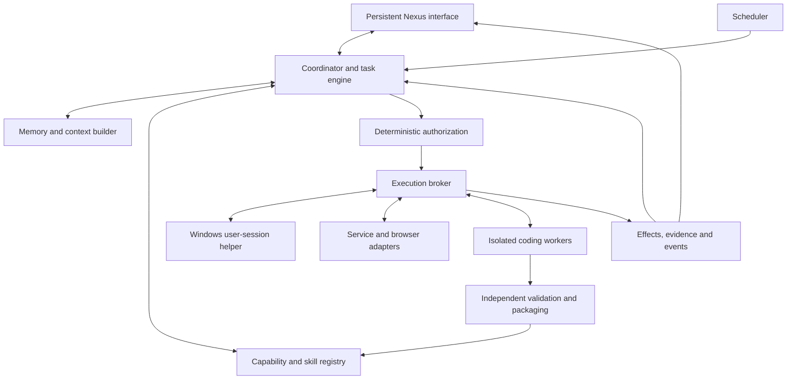
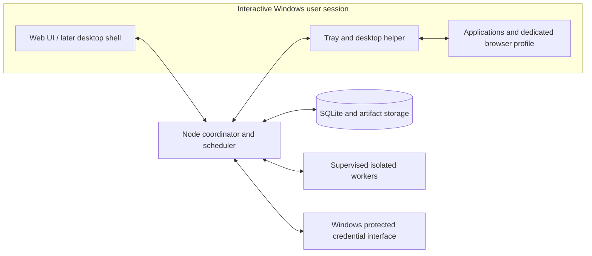
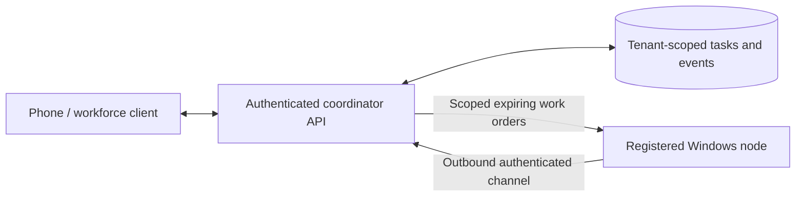

# Nexus personal assistant: reconciled architecture and build plan

Design revision: November 11, 2026. This is a proposal, not a claim of delivered capability. The owner reuploaded the 50-section architecture specification and requested reconciliation before further implementation. Nexus replaces JARVIS throughout. Sample scenarios are not live work orders and are not included as operational tasks here.

## Product and established decisions

Nexus is one personal assistant that owns goals across conversations, business screens and model changes. It interprets requests, retrieves relevant memory, plans, delegates, checks effects and follows through. Tools and reusable skills expand its capabilities; the interface is not a ceiling of predefined workflows.

The normal experience is a persistent conversation with visible listening, speaking and task status. Business workspaces provide focused views of the same underlying work. Internal adapters, hashes and debugging belong in expandable technical views rather than the first screen.

| Requirement | Classification | Proposed treatment |
| --- | --- | --- |
| Nexus identity; Windows first | Established | Preserve existing repository and Windows launcher |
| Voice available across management screens | Established | Root-mounted conversation controller; native tray/helper later |
| Dark background, cyan accents, clearer navigation | Established | Navy surfaces, high-contrast text, restrained cyan status/action accents |
| Persistent memory, rules and tasks | Established | Application-owned transactional records, independent of model provider |
| Broad files, browser, applications and terminal capability | Established target | Incremental execution broker and Windows helper; current read-only search remains useful |
| Use Codex and Claude as workers | Established target | Separate adapters with bounded work orders and supported authentication |
| Gemini free now, paid later | Established | Retain separate public-only Gemini; no private-context fallback |
| Daily brief | Established | Cape Coral timezone America/New_York, weekdays 05:00; protect 08:00–11:00; Monday week view |
| Cross-platform customer/workforce apps and subscriptions | Established target | Separate named identities and company isolation before external users |
| Booking, monitoring and archive examples | Illustrative only | No real bookings, applications or sample data created |
| Continuous operation while PC is off | Later deployment choice | Requires another available execution/delivery node |

## Current baseline and gaps

Repository features and the owner's laptop observations are different evidence. These observations are reported by the owner; this design review did not independently inspect their accounts or laptop.

| Area | Existing evidence | Remaining work |
| --- | --- | --- |
| Conversation | Local Ollama answers and local voice reported working | Persistent cross-screen assistant, interruption polish, clearer status |
| Knowledge | Selected laptop folder, Obsidian notes and Google snapshots searched | Broader coverage, OCR, relationship graph, fine-grained sharing |
| Google | Two calendar accounts and six selected Drive documents reported readable | Gmail, writes, delivery, additional workflow-specific connectors |
| Gemini | Public-only generation reported successful | Paid/private mode requires a separate reviewed change |
| Foundation | SQLite tasks/memory and planning coordinator implemented | General execution contracts, effect reconciliation and durable work history |
| Coding | Codex candidate generation, checks and isolated USD utility verified in walkthrough | General skill contracts, additional verification profiles, Claude adapter, release supervisor |
| Co-hosting | Internal lead/estimate/job rehearsal implemented | Named customer/workforce accounts, actual photos, invoices and provider reconciliation |
| Automation | Fixed service maintenance and morning scheduling implemented | General Windows actions, browser control, monitors and tested recovery |

## Logical architecture and responsibility



The model proposes interpretation, plans and candidate lessons. Software validates schemas, permissions, revisions, schedules, leases, budgets and transitions. An adapter reports observations; the verifier checks task acceptance criteria. A model declaring success cannot complete a consequential task by itself.

| Component | Input/output | Authoritative state | Dependency/failure behavior |
| --- | --- | --- | --- |
| UI | Commands, corrections, events and artifacts | Draft text and presentation preferences only | Reconnect from event cursor; do not resend unknown actions |
| Coordinator | Task revisions → work orders and progress | Tasks, plans, checkpoints | Recover durable state after restart |
| Context builder | Task scope → relevant sourced context | No separate competing memory | Mandatory rules cannot be removed by relevance ranking |
| Policy | Typed action + grants → decision and reason | Versioned rules/grants | Missing rules store blocks affected actions |
| Broker | Approved invocation → execution receipt | Invocations, resource leases | Recheck revision and expiry immediately before dispatch |
| Helper/adapters | Typed operations → observations | Account/session references and operation cursors | Return authentication/device/uncertain-effect states |
| Registry | Capability query → compatible versions | Descriptors, skill versions, health | Exclude disabled/incompatible versions |
| Workshop | Bounded work order → candidate artifacts | Candidate and validation evidence | Never edit the active runtime in place |
| Scheduler | Durable schedule → task occurrence | Timezone, recurrence, cursor, receipt | Deduplicate runs and apply explicit missed-run policy |
| Verifier | Acceptance criteria + observations → outcome | Evidence references and verdict | Surface partial or unknown effects |

## Windows deployment and later devices



Start with the existing Node/Next application, Python speech worker and SQLite foundation. Add a narrowly scoped Windows helper only for capabilities that need native APIs. The web UI does not run as administrator. Administrative work uses a separate explicit elevation path; UAC and protected desktops may require owner participation. A Windows service cannot be assumed to control the interactive desktop.

At login, the launcher/supervisor starts configured components and checks readiness. A browser close ends browser microphone capture; already durable server work can continue while its processes remain alive. Lock pauses interactive desktop actions. Sleep pauses local execution; resume reconciles interrupted actions before retrying. Shutdown/sign-out availability depends on process deployment and must be tested. Crashes expire leases and preserve uncertain effects. Updates checkpoint work, back up state and use a separately recoverable supervisor.



Later cloud coordination uses device registration, rotating credentials, revocation, sequence numbers and reconnect cursors. Commands have stable IDs, expiry and deduplication records. An offline node does not receive expired work on reconnect. One configured deployment owns each task's authoritative state; clients cache views. Sensitive policy conflicts require reconciliation rather than silent last-write-wins. A phone app does not automatically gain control over other phone applications.

## Task ownership, workers and state machines

One coordinator owns each task. A worker receives objective, task revision, relevant sources, allowed resources/actions, deadline, budget, output schema and verification requirements. Independent work may run concurrently in isolated workspaces; shared desktop/profile/project resources require leases. Worker output remains evidence to assess, not authoritative completion.

```text
accepted → planned → running → verifying → completed
            ↕          ↕          ↓
       clarification  waiting   partial / failed
                       auth / device / quota / decision
Any nonterminal state → paused / blocked / cancelled
Resume → recheck current revision, authority, external state and resources
```

External effects have a separate lifecycle: prepared → authorized → dispatched → acknowledged → observed → verified. A timeout after dispatch becomes uncertain, then reconciled. Provider idempotency keys are used where supported; otherwise query external state before retrying. Cancellation stops pending work, not history. Completed payments/messages remain reported even if the parent task is cancelled. Compensating actions are separate scoped operations.

Owner corrections increment task revision, invalidate pending conflicting dispatches and notify workers. Leases carry fencing generations where the execution surface can enforce them; software must not claim fencing guarantees for arbitrary unrestricted code. Human mouse/keyboard takeover pauses desktop actions and requires a fresh observation before resumption.

## Memory, rules and context

SQLite is authoritative for profile/preferences, scoped facts, projects, commitments, entities/relationships, corrections, rule revisions and task/event references. Skills live as versioned packages referenced by database records. Credentials live outside general memory. Markdown/Obsidian is source material or an explicit export/import surface, not a second silently competing authority.

Each memory fact records source, stated/observed/inferred status, scope, sensitivity, observed/valid/expiry dates, active/disputed/superseded status and correction links. Inferred facts never silently override explicit owner instructions. A client-only tone preference stays attached to that client.

Context assembly: resolve task/project/entities; load applicable mandatory rules; retrieve current relevant facts and commitments; search sources and skills; check freshness/contradictions; select under a budget; attach source IDs. Begin with text search and relational links. Add embeddings only after measured retrieval gaps justify them; text retrieval must keep working without an embedding provider.

Corrections update authoritative records transactionally, supersede old facts, invalidate summaries/indexes and notify affected active work. Explicit “remember” requests have a direct write path. Candidate lessons from workers require validation. If a memory write fails, preserve the result and report that saving failed.

Deletion removes active payloads and derived indexes/caches, and propagates to synchronized copies. Historical artifacts and backups require their own retention treatment; do not promise instant forensic deletion. Backups need transactional snapshots, restore tests and migration checks. Existing foundation storage is not automatically encrypted by this proposal; disk protection, Windows ACLs and recovery keys need native validation.

Rules distinguish advisory preferences, procedural guidance, hard constraints, standing grants and one-task exceptions. An authorization decision binds task/action parameters, account, resource scope, policy revision and expiry. Recheck changed recipients, prices and destinations. Already authorized necessary steps do not trigger redundant prompts. A connector's installation is not permission for every action it exposes.

Retrieved web pages, documents, emails and generated artifacts cannot rewrite owner policy. Browser speech is not proof of owner identity for consequential actions. Credential operations return narrow handles where possible; raw tokens do not enter prompts or ordinary logs. Unrestricted code running as the same Windows user can bypass application-level checks, so stronger containment requires an actual OS boundary, not a prompt or wrapper.

## Capability registry, execution and connectors

A tool performs an operation; a connector binds a service/account; a model adapter handles inference; a worker performs bounded delegated work; a skill describes a reusable method; a workflow composes steps; a plugin packages capabilities. Every callable descriptor declares version, schemas, prerequisites, account/environment, effects, scopes, cost/rate behavior, cancellation and verification.

Search descriptors by intent, resource, health and permission scope rather than loading the entire catalog into every prompt. Health states include installed, available, needs authentication, degraded, outdated, disabled and unsupported.

Prefer supported APIs/CLI, then structured browser/application automation, then visual interaction when appropriate. A denied API scope cannot be bypassed by browser fallback. Use a dedicated automation profile by default; owner-session integration can follow explicit supported attachment and account checks. Re-observe after navigation or page changes. Verify the service result rather than treating a click as success. MFA/CAPTCHA and expired access may require owner action.

Shell invocations use executable plus argument arrays, bounded output/time, declared working directory, controlled environment and process-tree supervision. File tools enforce target paths, link/junction behavior and operation type. Reads, writes, deletes, sends, purchases and access-control changes are distinct scopes.

Retain Google Calendar and selected Drive/Docs/Sheets reads. Add Gmail/drafts/delivery, Tasks/Contacts and business-specific Google services incrementally with actual scopes. Gemini Public remains isolated from private memory, history, voice and sources. Paid/private Gemini is a new configuration/release decision. Claude, Copilot and DeepAI require supported interfaces and account/terms validation; subscriptions are not assumed to provide API credits or redistribution rights.

## Skills, development and recursive improvement

Skill packages contain a readable procedure, manifest, optional executable assets, tests/fixtures, provenance and changelog. The manifest includes trigger/exclusion conditions, parameters/results, compatibility, dependencies, permissions/effects, execution strategy, acceptance/verification, recovery, resource estimates and evidence.

Lifecycle: draft → under test → validated → active; failures can mark degraded/quarantined; replacements supersede old versions. Tasks pin versions. Disablement stops future invocation without deleting historical evidence.

Learning loop: observe request/failure → classify missing knowledge/tool/access/environment/reliability → search existing solutions → define measurable method → bounded experiment or development work order → independent verification → versioned skill/tool improvement → resume original task → measure later outcomes. Parameter changes alone do not create duplicate skills. Memory updates do not train model weights.

Development stays in isolated workspaces with minimized data. Candidate-supplied tests supplement, not replace, independent checks. Promotion checks contracts, effects, dependencies, regression evidence and permissions. The existing USD utility pipeline is a narrow proof of this pattern, not a general plugin sandbox. Arbitrary Windows tools require their own execution isolation and verification profiles.

Core updates use a supervisor outside the component being replaced, schema compatibility checks, pre-migration backup and tested recovery. UI/configuration/skill/connector/core changes have different release policies. Generated changes cannot silently broaden authority, weaken verification or erase failure history. Bound repair depth, builders, time, tokens and spend; stop cycles with no new evidence while preserving actionable work.

## Interface, voice and visual design

Proposed layout: compact navigation for Today, Work, Knowledge and Connections; a persistent Nexus conversation drawer/dock on management screens; focused workspace content; expandable technical details. Separate Google accounts, Google files, laptop sources, model providers and laptop services rather than one long Connections form. Co-hosting shows clear intake → estimate → job → review stages with next actions.

Use navy backgrounds, visibly distinct panel surfaces, readable neutral text and cyan emphasis. Provide keyboard focus, text labels, adequate contrast and reduced-motion treatment; do not use green or animation alone to convey status. A knowledge graph must display real source relationships and open the underlying evidence; it does not itself grant access.

Root-mount one browser conversation controller so tab changes, drawer minimization and client-side management navigation do not destroy its state. Keep microphone off during model thinking and speech playback in the current loop. Show listening/muted/thinking/speaking/resume states and a prominent mute control. Stopping speech, pausing listening and cancelling a task are separate actions. Preserve selected voice and explicit saved auto-resume preference. Initial browser permission/autoplay gestures can still be necessary. Browser capture ends on close/navigation/sleep; native continuous operation/wake word requires separate implementation and testing.

Images, OCR, visual interpretation, generation and editing are separate capabilities. Screen capture is on demand or explicitly scoped to a chosen window. Prefer accessibility trees/structured data when reliable; pixel interaction requires current coordinates, display scaling, monitor identity, freshness checks and post-action verification. Ambiguous recipients, amounts or destructive voice instructions require correction before dispatch.

## Scheduling, resources and costs

Schedules are deterministic records with timezone, recurrence, target capability, scope, cursor and delivery policy. DST, resume and duplicate-process behavior require tests. Brief opening and voice-start triggers reference the same local-day snapshot to prevent duplicate delivery. Email requires a working authorized delivery adapter and receipt; it is not already enabled by Calendar access.

Alarms, reminders, monitors and scheduled tasks have distinct missed-run policies. A monitor persists a cursor, matching criteria, deduplication, quiet hours and meaningful-change threshold. Monitoring does not authorize applications, messages or purchases. Keep unchanged results quiet. Local powered-off delivery remains unavailable without another node.

Budgets apply per owner/provider/task/worker/development project. Track billed, estimated and unknown usage separately. Deterministic polling does not repeatedly call a model. Do not silently switch to paid fallback. Default to one expensive local inference/build at a time on the owner's 8 GB laptop; validate actual resource pressure before increasing concurrency.

## Contract notation and interfaces

All persisted records have stable IDs, schemaVersion and timestamps. Mutable records add revision; sensitive fields carry scope/retention classification. The following are required proposed fields beyond that common envelope, not existing API promises.

| Record | Required fields and references | Owner/lifecycle |
| --- | --- | --- |
| Task/revision | originalRequest, objective, intent, scope, assumptions, criteria, policyRef, budget, deadline, parentId | Coordinator; revisioned states above |
| Plan step/work order | taskRevision, dependencies, capabilityRefs, resources, allowedEffects, outputSchema, verification, leaseRef | Coordinator; queued/running/result |
| Invocation/result | taskRef, actionId, argumentsRef, accountRef, grantRef, idempotencyKey, status, evidenceRefs, uncertainty | Broker; effect lifecycle |
| Capability | identifier, version, schemas, prerequisites, effects, scopes, health, cancellation, verification | Registry; versioned health |
| Skill/execution | packageHash, permissions, procedureRef, tests, compatibility, pinnedVersion, invocationRefs | Registry; draft through retired |
| Fact/correction | type, contentRef, scope, provenance, trust, sensitivity, validTimes, status, supersedes | Memory; active/superseded/deleted |
| Rule/decision | source, actions/resources, conditions, revision, expiry, precedence, rationale, parameterHash | Policy; active/revoked/expired |
| Schedule/cursor | timezone, recurrence, target, missedRunPolicy, lastOccurrence, sourceCursor, deliveryRef | Scheduler; enabled/paused/cancelled |
| Event/evidence | correlationId, taskRef, actor, kind, metadata, payloadRef, observedAt, retention | Event store; append metadata, removable payload |
| Artifact | contentHash, storageRef, mediaType, generatingTask, sensitivity, provenance | Artifact store; retained/deleted |
| Device/advertisement | publicIdentity, ownerOrTenant, capabilities, sessionState, policyRevision, lastSeen | Registration; enrolled/revoked |
| Lease | resourceRef, taskRef, holder, fencingGeneration, expiry, heartbeat | Broker; held/expired/released |
| Improvement/release | parentTask, hypothesis, candidateHash, evaluations, migration, rollback, approvalRef | Workshop/supervisor; candidate/active/reverted |

UI commands return a durable task ID for long work; reads and local validation can be synchronous. Events stream/replay by cursor and correlation ID. Workers receive revision-bound orders; cancellation and steering are explicit messages. The broker checks policy independently of model text. Registry activation requires verified artifact hashes and declared permissions. Migrations version schemas and preserve recoverable backups; incompatible nodes refuse unsupported commands.

Shared errors: invalid_input, permission_missing, credential_missing, device_unavailable, unsupported_operation, transient_service_error, rate_limit, uncertain_effect, verification_failed. Return retryability, affected step, sanitized diagnostics and next useful action. Never reduce uncertain effects to a success boolean.

## Build sequence and acceptance

| Milestone | User-visible result | Dependency and acceptance evidence |
| --- | --- | --- |
| 1. Reconciled assistant shell | Conversation available across management screens; clearer navigation and dark/cyan hierarchy | Preserve existing APIs; desktop/mobile screenshots, keyboard checks, one voice instance across navigation, mute/auth-loss tests |
| 2. Unified task ownership | Conversation can create/steer durable work with recoverable state | Revisioned contracts, event/artifact history; restart and cancellation tests; novel composed task without fixed menu |
| 3. Memory and policy integration | Relevant corrected preferences/rules survive restart and apply to pending work | Transactional correction, scoped retrieval, policy dispatch recheck and deletion tests |
| 4. Windows execution | Authorized file/process/browser actions with honest availability and takeover | Broker/helper contracts, native Windows test environment, path/account verification and uncertain-effect recovery |
| 5. General development path | Missing capability can be built, independently checked and used to resume parent task | General manifests, isolated workers, appropriate verification profiles, rollback and bounded repair tests |
| 6. Daily reliability | Scheduling, quiet monitoring, delivery receipts and supported native invocation | Missed-run/DST/crash tests, actual authorized delivery acceptance |
| 7. External business apps | Customers/workforce submit scoped evidence and managers review | Named identity, tenant/assignment isolation, private uploads; sandbox financial reconciliation before live payments |
| 8. Commercial/remote operation | Subscription onboarding and later phone/cloud continuity | Provider embedding rights, tenant restore/isolation, device revocation, billing/support and real pilot evidence |

These stages extend the existing foundation; they do not claim that milestone 1 alone completes general capability. No confident delivery date is assigned without native helper, provider and commercial-scope discovery.

## Failure and verification matrix

| Scenario | Expected behavior | Evidence type |
| --- | --- | --- |
| Restart mid-task | Recover checkpoint; reconcile dispatched effects | Deterministic + integration |
| Corrected preference | Invalidate stale context; update relevant workers | Deterministic |
| Mid-task rule change | Reject stale dispatch generation | Deterministic + integration |
| Novel task | Compose tools or preserve parent while resolving gap | Simulated end-to-end |
| Known task | Reuse compatible pinned skill | Deterministic + integration |
| Lucky successful skill run | Keep unvalidated generalization in draft | Holdout evaluation |
| Worker falsely reports success | Acceptance verifier withholds completion | Simulated negative case |
| Resource conflict | Lease/isolation prevents silent overwrite | Concurrency integration |
| Owner takes desktop | Pause, yield and re-observe | Native Windows |
| Wrong account active | Block dispatch until account matches | Adapter integration |
| Locked/offline PC | Queue or show waiting; no fake success | Native Windows |
| Quota exhausted | Bounded wait/authorized fallback | Mocked provider |
| Request times out after send | Reconcile before retry | Simulated uncertain effect |
| Price/terms changed | Re-evaluate grant before commit | Adapter contract |
| Document contains commands | Treat as data; keep owner objective | Adversarial fixture |
| Skill asks broader access | Existing policy denies expansion | Deterministic |
| Dependency installation fails | Preserve parent and diagnostics | Workshop integration |
| Alarm missed in shutdown | Apply configured missed-run policy | Simulated clock + native |
| No monitor change | Update cursor quietly | Deterministic |
| Monitor cancelled | Stop future runs/notifications | Scheduler integration |
| Memory deleted | Remove active/derived content; disclose backup retention | Storage/restore |
| Rules database unavailable | Block affected execution | Fault injection |
| Self-update fails | Supervisor restores tested compatible version | Packaged native recovery |
| Tool tries changing policy | OS boundary prevents unauthorized access where configured | Isolation integration |
| Misheard amount/recipient | Resolve material ambiguity | Voice simulation + native |
| Uncertain image observation | Re-observe or explain uncertainty | Visual fixtures |
| Recursive repair cycles | Stop at configured limits; retain evidence | Deterministic |
| Reconnection repeats command | Reject expired/duplicate occurrence | Protocol integration |
| Planning-only request | Produce artifacts without external effects | End-to-end |
| Model replaced | Preserve tasks/memory/policy/identity | Adapter contract |
| Cross-screen voice navigation | Keep one session; mute stays available | Browser integration |
| External customer accesses owner data | Deny outside company/assignment scope | Commercial isolation tests |

Record concise decision summaries, not hidden reasoning. Observability links task, action, account/resource, version, policy and evidence. Track verified completion, corrections, retries, latency and cost without retaining unnecessary sensitive payloads. Test only changed behavior and relevant regressions; native effects require an authorized real environment.

## Decision log, traceability and verification limits

| Decision | Recommendation and rationale | Alternative/consequence or evidence needed |
| --- | --- | --- |
| Local ownership | Keep current local coordinator and SQLite | Cloud always-online operation adds deployment and privacy obligations |
| Interface | Improve existing Next UI first | Desktop shell/helper later for tray/global invocation; validate packaging/license |
| Languages | TypeScript core, existing Python speech; minimal native helper | Avoid unrelated service/language proliferation |
| Memory | Relational records + text search + readable exports | Embeddings only after retrieval evidence; no mandatory graph database |
| Model strategy | Replaceable adapters; no silent paid fallback | Verify each account's supported integration and usage reporting |
| Permissions | Typed broker checks and scoped grants | Arbitrary same-user code is not a hard sandbox |
| Browser | Dedicated automation profile | Existing-session attachment needs explicit supported account handling |
| Updates | External supervisor and tested recovery | In-place self-modification cannot guarantee rollback |
| Phone | Shared API/contracts now; client later | Full phone OS automation remains platform-specific |

Major requirement traceability: one identity → coordinator/task IDs → steering/restart tests; persistent memory → fact/correction contracts → restart/correction tests; broad access → broker/helper/invocations → native/account/takeover tests; learning → manifests/workshop/releases → holdout/rollback tests; voice/UI → root controller/events → navigation/mute tests; proactive work → schedules/cursors → DST/missed-run tests; business subscription → tenant/assignment contracts → isolation/sandbox tests.

No current provider documentation was live-verified in this reconciliation. Existing code and prior owner walkthroughs establish the baseline above; they do not establish future entitlement. Before implementing new provider/native adapters, check official Codex authentication/programmatic interfaces, Claude Code/Agent SDK authentication and embedding terms, Microsoft interactive services/UI Automation, Google scope/data handling documentation and each connector's limits. Record URL, date, specific claim and confirmed/inferred/unverified status. Do not assume the uploaded model target label is an available model identifier. Existing architecture links are research starting points, not verified guarantees.

The first implementation boundary is milestone 1: persistent assistant placement, clear navigation, accessible dark/cyan styling and preservation of existing voice/privacy/authentication behavior. It does not add arbitrary terminal execution, Gmail sending, payments, extra providers or native microphone capture. Proposed later decisions are whether always-online availability justifies a cloud coordinator, which bounded action classes may execute under standing grants, and what native helper/desktop packaging to adopt after compatibility validation. Existing free-tier Gemini and no-live-money configuration remain in force while those choices are unresolved.
