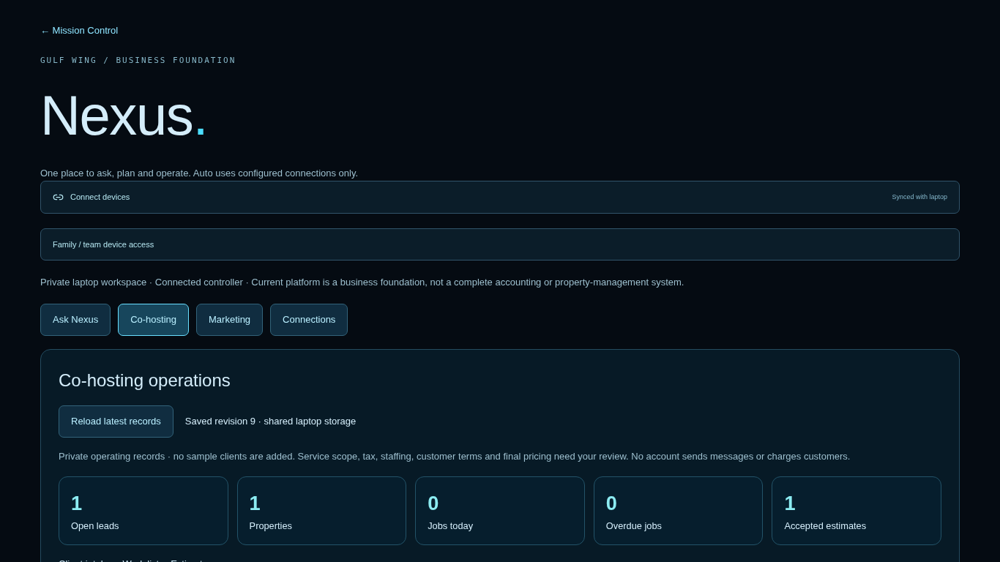
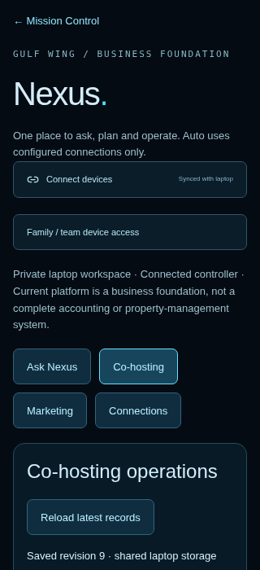

# Co-hosting operating workspace review

Previously the Co-hosting screen could save a name, notes and a draft calculator result, but could not edit contacts, schedule a job, track a checklist or turn an accepted estimate into work. This release provides the local day-to-day workflow for two trusted operators while keeping external integrations explicit.

## Resulting workflow

- Review an editable service catalog; deactivate services without deleting their history.
- Capture leads, contacts, addresses and follow-up dates; prepare a separate property from a lead.
- Create and edit scoped estimates with customer/property/service links and editable cost/margin assumptions.
- Print a customer copy or save it as a PDF without rendering internal wage, burden or margin inputs.
- Manually record Sent, Accepted or Declined, then turn an accepted estimate into one linked job with a date, assignee and quality checklist.
- Filter records by type, due date or overdue status; search by contact, location or assignee.
- Export and validate a private business backup; require explicit confirmation before replacement restore.
- Import original PDF/XLSX files and notes directly, preserving unrelated sources and replacing previous uploads with the same file name.
- Retrieve imported plans and saved operating snapshots through Nexus. Current-question matches take priority over earlier conversation topics; five-passages maximum is explicit in the model prompt.

No customers are seeded. Starter services and cost inputs are reviewable templates and planning assumptions. A manually recorded acceptance, completion or sent status is not proof of a signature, payment or delivery.

## Shared devices

A phone or Chromebook can use the ASUS-hosted browser interface on the same trusted Wi-Fi. A paired controller can use the same business workspace. Saved data refreshes approximately every eight seconds when there are no unsaved edits. Dirty forms show a newer-data warning, stale writes get HTTP 409, and edits compare their original record against the latest version before replacement. Failed optimistic saves roll back displayed records while keeping the form.

The access panel shows authenticated private network addresses and setup instructions. Existing pairing/origin protections also cover import, export and address discovery. Controllers share permissions; there is no named identity or per-employee audit trail. Phone/Chromebook microphone use requires HTTPS. No away access, public URL, router forwarding or TLS provisioning is enabled.

## Storage and source handling

Existing business records load with their original statuses. Optional contact/scheduling fields and starter services are added without requiring a destructive reset. Server validation bounds collection sizes, text, dates, email shape, numeric inputs and links. Atomic writes and revision checks retain the shared storage model.

Imports accept up to ten files / eight MB per request, with a two-MB per-file limit. PDF page and expanded workbook archive sizes are bounded. Workbook caches are read without evaluating formulas or external links. A whole import batch is prepared before the private index is atomically updated, and mutations share a process-wide queue. File names are metadata and hashed identifiers, never output filesystem paths.

The supplied four PDFs and workbook were imported into disposable private storage: 69 sections, 243,219 serialized bytes, five source files. Reimport retained 69 sections. A plan-based query returned Co-hosting page references. Source files and their extracted text are not committed. Synthetic PDF/XLSX fixtures under tests/fixtures contain no customer or business-plan data.

## Validation

Production build and TypeScript passed. Final browser suite: **124 passed, 8 existing duplicate host-matrix cases skipped**. Local AI setup and synthetic model/voice protocol checks passed; Python voice worker: 9 passed; real PCM audio-decoder compatibility: 1 passed. Production dependency audit: 0 vulnerabilities. Original-file import/reimport/source-reference checks also passed in disposable private storage. Remote CI must still run on the PR; these are local results.

Browser coverage includes legacy migration, intake/editing, estimate acceptance and one-job conversion, checklist saving, print formatting, a separate controller refreshing and retaining unsaved drafts, stale-write rejection, file extraction and browser upload, private backup restore, service editing/deactivation, display-role restrictions, and 320px/Chromebook layouts.

The browser suite uses one worker because fixtures share one laptop data directory. Dedicated tests still create independent device contexts and concurrent API requests to check real conflict handling. Model/voice protocol fixtures are synthetic; actual laptop inference quality and timing are not claimed from CI.

## Operator handoff and next stages

Use [the day-one guide](cohosting-day-one.md) for separate-copy Windows update commands, document import, a morning acceptance check and the wife's device pairing steps. The added npm ready command reports setup state and LAN addresses without printing secrets or customer content.

Next stages: private access while away with HTTPS; named accounts and per-user permissions; durable multi-company storage and recovery; accounting/invoicing/payment integrations; authenticated marketing/provider adapters and approval policies. No paid services, credentials, outgoing communications, spending or deployment are added by this release.

## Screenshots

Synthetic test records only; these are not customer data or live business performance.

