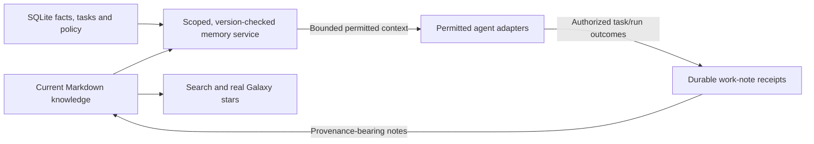

# Applied video and screenshot contract for Nexus memory

This document applies two separate owner-supplied references: the hour-long course's [Obsidian excerpt and images](references/second-brain-video-owner-excerpt.md), whose URL is not established, and the fourteen-minute JARVIS video's [transcript chapter index](references/jarvis-video-owner-transcript.md) and [workspace images](references/jarvis-workspace-owner-images.md). The owner confirmed [this YouTube link](https://www.youtube.com/watch?v=xW77SSvuto0) for JARVIS and supplied its transcript through 14:05. Direct YouTube retrieval is blocked, but that supplied transcript is now available. The references have different time ranges and must not be merged into one video. See [the applied JARVIS capability plan](nexus-jarvis-capability-plan.md).

The owner wants one lasting second brain that permitted agents can read and improve, explored through a luminous, rotatable Galaxy of real files and notes. Changing an agent/model must not discard the work history. The latest explicit owner choices govern the interface: keep the original spiral, no drawn file connections, quiet names, fullscreen and free rotation.

## Additional JARVIS workspace images — November 25, 2026

The owner subsequently supplied five images of the JARVIS memory workspace. [The image evidence record](references/jarvis-workspace-owner-images.md) distinguishes visible controls from unverified behavior and from the earlier video/transcript. Apply the following as a workspace refinement around the Galaxy:

| Observed element | Nexus requirement | Implementation boundary |
| --- | --- | --- |
| Central full-screen field with differently colored clusters and small captions | Let the Galaxy dominate the screen. Reuse the spiral with real grouped file/memory objects, quiet labels and free orbit/zoom. | Preserve the existing no-lines instruction. Colors must correspond to known categories or explicit grouping; never invent records or relationships. |
| Left search and selected-node inspector | A collapsible library/inspector rail: find a real record, focus its star, inspect source/type/workspace/version, and explicitly open it. | Focusing remains metadata-only. Search-to-star focus across the full memory catalog is pending; current page/index-name filtering is not global search. |
| Top-hubs list | Optional real navigation shortcuts to highly linked notes or frequently used locations. | Link degree must come from resolved explicit links within a stated catalog. Usage ranking requires its own recorded usage basis. Do not fabricate popularity or copy demo rankings. |
| Right category filters and counts | Compact filters for actual sources/types/workspaces with current counts and coverage. | The pictured Router/Wiki/Skills/etc. categories are examples; Nexus may show only categories it actually stores. Provider/account permissions must still filter private results. |
| Fit and layout controls | Fit current visible objects; offer meaningful layout-spacing controls where implemented, plus reset/orbit/zoom. | A control must change the real layout. A Link length control is unnecessary when no connection lines are drawn. |
| Assistant ring and status/model area | Optional compact assistant presence with the real local/provider state and explicit permitted controls. | Configured, signed in, live ready, listening and active are distinct states. No copied ONLINE/model badges. This indicator must not obstruct file access. |
| EYES / HOLO / FOCUS / REFLEX controls | Treat as ideas to define separately, not existing capabilities. A display-only focus mode could hide peripheral UI. | Screen/camera capture, background listening and autonomous actions need their own implemented contracts and actual permissions. Image labels enable none of them. |
| Bottom command bar | Keep typed/voice Nexus commands reachable in expanded views without covering the selected star. | Microphone status and provider-sharing choices stay explicit. A visual command bar does not add new execution authority. |

On laptop/fullscreen, the target arrangement is **collapsible library/inspector at left → large Galaxy in the center → compact filters/assistant status at right**. On a phone, use drawers or bottom sheets and large touch targets; do not shrink both desktop sidebars into the Galaxy. Keep breadcrumbs, a conventional list and direct source-opening actions available.

These images add navigation and workspace requirements. The earlier spiral reference still supplies the visual base; the owner's explicit no-lines and contextual-label choices remain current. Neither reference demonstrates that the current Nexus has a complete multi-agent memory service, a camera feature or unrestricted background automation.

## What the pictures mean for appearance

| Picture feature | Build requirement | Current gap or constraint |
| --- | --- | --- |
| Dark indigo/purple space, glowing lilac/white core and cyan/magenta outer arms | A deep luminous spiral with layered depth and soft glow, not a flat graph or a grid of cards. Retain the recognizable Nexus spiral geometry. | Current renderer uses the original blue/cyan holographic palette. Closer purple/white lighting, particle depth and arm glow need a dedicated visual refinement. |
| Bright individual points among faint background particles | Real notes/files have distinct selectable stars; ambient dust is decorative and never counted as stored memory. | Delivered distinction; coverage is bounded by the actual source view. |
| Only a handful of floating names | Default names appear on hover, focus or selected objects; show full names in an inspector/list, and offer an optional all-names switch. | Delivered by the latest label update; do not restore a label on every idle star. |
| Oblique perspective changes between screenshots | Free two-axis orbit/rotation, zoom and stable orientation during expansion; mobile drag and keyboard alternatives. | Rotation, zoom, persistent expansion and direct fullscreen delivered. Smooth target-to-target camera travel and richer depth remain refinements. |
| Explore/search and expand controls | Search should find a real record and focus it; fullscreen should keep the current selection and navigation. | Existing page/index name filters and list alternatives are delivered. Unified full-memory search-to-star focus is pending. |
| Graph groups and note edges in the first screenshot | Preserve real relationships as data and in the inspector: explicit links, folder membership, or separately verified semantic evidence. | Explicit wiki links and folder neighborhoods exist. Visible connecting lines remain off by the owner's explicit preference. |
| Memory/connection counts | Counts must describe current real records and verified links, with freshness/coverage limits. | Existing file counts are bounded source counts, not a complete global second-brain count. Verified global memory/link metrics are pending. |

Do not copy the video's brand, exact demo note titles, people, project names, or counts into the owner's data. Use the pictures as appearance and interaction evidence.

## What the transcript means for operation

1. **Model-independent durable memory.** Knowledge Markdown lives in the selected Obsidian-compatible vault. SQLite remains authoritative for owner facts/instructions, tasks, permissions and write receipts. Source notes remain knowledge evidence. This split prevents exported historical snapshots from silently becoming current owner truth.
2. **Agents retrieve relevant context.** A common memory access contract must select records by workspace, current access, relevance and freshness; return bounded text plus source IDs/revisions/hashes and verification state. This is retrieval, not model training. A model switch can reuse permitted history when its adapter supports the contract.
3. **Authorized work produces memory.** Preserve the already enabled completed-task journal. Extend permitted agent adapters to report their run/task identity, actions, artifact references, decisions and outcome through the same durable receipt process. Record unverified output as unverified; saving an agent answer does not establish a fact or execution success.
4. **Updates become discoverable.** A confirmed note save has a separate indexing/discovery result. Keep pending indexing visible; add the confirmed version to search/Galaxy when eligible. Current journal/save indexing already implements the first slice. A failed or uncertain save must not be silently replayed.
5. **Continuity must respect corrections.** Current task context can use live SQLite records. A synchronized current-note layer still needs stable IDs, conflict handling, supersession and correction/forgetting semantics. Retained snapshots and historical journal notes must not override current facts after edits or deletion.
6. **Permitted agents are real adapters.** Local Ollama retrieval is implemented; coding-worker and future agent memory access must use explicit adapter contracts. Chat subscriptions, a CLI sign-in or a selected vault do not prove a general connected agent. Preserve provider-sharing controls and local-only owner-memory exclusions.
7. **One shared workspace across devices.** A phone or ScreenPad navigates the laptop-hosted memory under its controller role. Other hosts and native phone storage need their own adapters. Fullscreen visuals do not expand authority.

## Target data flow (not a claim that all adapters are connected)

Historical snapshots are separately identified and excluded from automatic context where required. Provider permissions still decide which portions, if any, can leave the host. The diagram describes the target integration; the delivery sequence below and existing memory documentation distinguish current slices.

## Keep storage navigation separate from assistant memory

The owner also requested Computer → Drive → Folder → File access. Browse-only drive/common-folder grants and the Storage galaxy supply that separate navigation layer. Displaying a drive, Downloads item or picture must not index its body, save it as an owner fact, send it to an agent, or create a note automatically. Knowledge stars and Storage galaxy may share the visual language while preserving their distinct coverage and permissions.

## Delivery sequence from the reference

| Stage | Concrete deliverable | Completion evidence |
| --- | --- | --- |
| 1. Governing reference | Record the source excerpt, screenshot interpretation, owner overrides and delivered/pending distinctions. | This document and the linked source record; the JARVIS transcript is owner-supplied; the separate hour-long source is still excerpt-only. |
| 2. Visual match | Refine the existing spiral's indigo/purple atmosphere, white/lilac center, cyan outer arms and depth, keeping quiet labels, no connections, selection and fullscreen. | Desktop/mobile captures compared to the supplied pictures, reduced-motion checks, contrast/touch checks and no regressions in real file opening. Do not substitute a new flat graph. |
| 3. Shared memory service | One adapter-facing retrieval envelope and work-note write receipt contract with workspace/current-version checks. | Two permitted adapter fixtures reuse the same current work note; denied scopes/providers cannot receive it; model identity changes without losing source provenance. |
| 4. Current-note lifecycle | Stable note identity, revisions, external-edit conflict detection and explicit supersession/correction/forgetting behavior. | Restart, external edit, conflict, delete/correct and uncertain-write tests; historical snapshots remain visibly historical. |
| 5. Search and scale | Search-to-star focus and actual memory/link metrics; bounded layouts/clustering for large collections. | Counts match the current catalog; omitted/offline records are disclosed; no fake stars, relations or “all memory” claims beyond coverage. |

These are implementation requirements, not permission to enable providers, change billing, send messages or rewrite owner-created notes. Existing authorized journal behavior continues; this reference adds no new runtime grant.

## Acceptance scenarios

- An authorized agent completes work; its confirmed, provenance-bearing note becomes discoverable. A second permitted adapter can retrieve the current relevant note after restart. Nothing implies the new model was trained on it.
- An owner correction or deletion takes precedence over older snapshots; stale notes do not reintroduce forgotten owner facts into automatic answers.
- A file star can be found, focused, orbited around and explicitly opened while preserving identity/version checks and fullscreen state. Focusing performs no content-read or provider request.
- The default scene reads as the supplied glowing spiral at laptop and phone sizes; labels do not obscure the arms. There are no visible file-connection lines.
- A browse-only folder can be explored and an original opened without being added to the knowledge index or model context.
- Unsupported, denied, removed, changed or offline resources have an honest result; a saved integration setting is not shown as verified cross-agent readiness.
